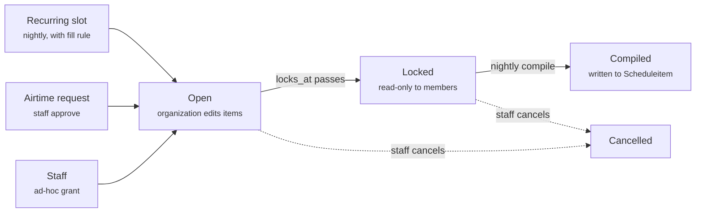

# ADR 0001: Airtime grants replace member scheduling

- Date: 2026-11-11

## Status

Proposed. Supersedes member scheduling through the schedule API, the weekly-slot filler and the jukebox gap filler in `agenda/scheduling/`.

## Context

Today the broadcast schedule (`Scheduleitem`) has three writers: member organizations through the API, a nightly weekly-slot filler, and a nightly jukebox that fills every remaining gap with filler video. Weeks are drafted two Mondays ahead, open to members for one week, then frozen. Most of the scheduling code exists to referee these writers.

- **No hard constraint on overlaps.** Every writer checks for conflicts and then inserts. `select_for_update` locks only rows that already exist, so two writers can take the same empty airtime.
- **A displacement rule every writer must know.** Jukebox filler gives way to member picks and slot placements, and the nightly run repacks the slivers left behind.
- **Reservations aren't real.** A weekly slot only holds airtime once a video is placed in it. A slot with no source, or the unused tail of a slot, is filled by the jukebox.
- **New slots start late.** The slot filler won't displace filler in frozen weeks, so a newly approved slot first airs one to two weeks out.
- **Slot owners and members compete.** Both count as deliberate programming, so whoever reaches the airtime first keeps it. In practice that's the nightly run at 00:05 on Monday.
- **Hours of filler.** The jukebox fills everything not otherwise programmed. The channel would rather air less, better programming.
- **Members work on the live schedule.** They have to understand freeze boundaries, open weeks and displacement to get on air.

## Decision

Organizations stop editing the schedule. Staff grant them windows of airtime, each organization fills in a list of what plays in its window, and a station-side compiler turns locked lists into `Scheduleitem` rows. Anything unprogrammed airs as broadcast graphics.

1. **Airtime grants** are the unit of allocation: one organization, one window, one ordered list of videos or live transmissions. Grants never overlap.
2. **Grants come from three places**: recurring slots (daily, weekly, fortnightly, monthly and so on, expanded by the nightly job), staff directly, or organizations' requests that staff approve.
3. **A grant locks** at a deadline, by default the Monday before its week airs. Staff can exempt a grant from locking, on their own or at an organization's request.
4. **Grants can fill themselves** from a fill rule: a pool of videos, an ordering and a mode (one video or fill the window). Recurring slots give each grant a default rule, so an organization that does nothing still gets its slot filled.
5. **The jukebox stops filling gaps.** It survives as a fill rule the station uses on its own recurring slots.
6. **Late uploads** use a video entry created ahead with its duration set by hand. The list is fixed at the lock; the file can follow.
7. **Graphics fill what isn't programmed.** Gaps, leftover time and empty grants show graphics, put up by playout, never as schedule items. There's no fixed broadcast day: members can schedule at any hour.
8. **Only the compiler and staff write `Scheduleitem`.**
9. **Scheduling moves into its own `scheduling` app**, with one service layer owning every state change and one module owning broadcast time (see [Related cleanup](#related-cleanup)).

## Airtime grants

A grant is a window of airtime given to one organization, plus the list of what plays in it. It's the only way deliberate programming reaches the air.

```python
class AirtimeGrant(models.Model):
    organization = models.ForeignKey(Organization, on_delete=models.PROTECT)
    airtime      = DateTimeRangeField()                  # half-open [start, end)
    locks_at     = models.DateTimeField()                # deadline for the organization's edits
    lock_exempt  = models.BooleanField(default=False)    # editable until air; edits recompile
    state        = models.CharField(choices=GrantState)  # open / locked / compiled / cancelled
    origin_slot  = models.ForeignKey(RecurringSlot, null=True, on_delete=models.SET_NULL)
    fill_rule    = models.ForeignKey(FillRule, null=True, on_delete=models.SET_NULL)
    granted_by   = models.ForeignKey(User, null=True, on_delete=models.PROTECT)
    edited_by    = models.ForeignKey(User, null=True, on_delete=models.PROTECT)
    edited_at    = models.DateTimeField(null=True)
    notes        = models.TextField(blank=True)

class GrantItem(models.Model):
    grant             = models.ForeignKey(AirtimeGrant, related_name="items", on_delete=models.CASCADE)
    position          = models.PositiveSmallIntegerField()
    video             = models.ForeignKey(Video, null=True, on_delete=models.PROTECT)
    live_transmission = models.ForeignKey(LiveTransmission, null=True, on_delete=models.PROTECT)
```

**Constraints**

- An exclusion constraint on `AirtimeGrant.airtime` (`&&`) for every grant not cancelled. It's a new table with no historical overlaps, so it can be strict from day one.
- `GrantItem`: exactly one of `video` and `live_transmission` is set.
- `GrantItem`: unique on `(grant, position)`, `DEFERRABLE INITIALLY DEFERRED`, so reordering inside a transaction doesn't trip it.
- The items' total duration must fit inside the window. No overruns.

**Rules**

- A grant may list any organization's video. The video's owner remains the responsible editor for what they publish, so eligibility checks the owner.
- `origin_slot` is provenance only. A grant copies the slot's time when issued, so editing or deleting a slot never moves an existing grant.
- `locks_at` is per grant. Slot grants default to the policy's freeze boundary; an ad-hoc grant at short notice gets its own deadline instead of being born locked.
- Items have no title or duration of their own. Metadata and length come from the video or live transmission.
- Items play back-to-back from the grant's start. Order is an integer position renumbered from 0 on every save: the API takes the whole list and replaces it in one transaction, so clients never send positions.
- `Scheduleitem.weekly_slot` is replaced by `Scheduleitem.grant`, nullable for staff entries and historical rows.

**Lifecycle**



- **Open.** The organization replaces its list as often as it likes.
- **Locked.** At `locks_at`, members can no longer edit. Staff still can until it's compiled.
- **Compiled.** The items are in `Scheduleitem`.
- **Cancelled.** Staff withdraw the grant, freeing its window.

A lock-exempt grant skips the lock: it stays editable until air, and every save after compiling recompiles it. A grant that locks empty compiles to nothing and airs graphics.

## Requests and lock exemptions

Organizations ask for airtime and for late changes through the same one-way request workflow weekly slots already use (`WeeklySlotRequestBase`): a staff decision with a required comment, recorded once.

```python
class AirtimeGrantRequest(ReviewedRequest):
    airtime = DateTimeRangeField()
    grant   = models.OneToOneField(AirtimeGrant, null=True, on_delete=models.SET_NULL)
    # _approve() creates the grant; fails if the window overlaps another grant

class GrantExemptionRequest(ReviewedRequest):
    grant = models.ForeignKey(AirtimeGrant, on_delete=models.CASCADE)
    # _approve() sets grant.lock_exempt = True
```

- **Airtime requests** name a window. Approval creates the grant. The request carries the same audit constraint as the slot requests, plus "approved if and only if `grant` is set".
- **Late changes mean exemption.** An organization that needs to change a grant after its deadline requests exemption. Staff can also exempt a grant on their own, typically around live broadcasts.
- **Only staff exempt grants.** Organizations can't set the flag themselves.
- Slot creation requests carry a recurrence (see [Recurring slots](#recurring-slots)). Approving a creation or ownership request also creates a default fill rule (see [Automatic filling](#automatic-filling)).

## Recurring slots

Recurring slots replace weekly slots. A slot is a recurrence rule, an owner and a default fill rule; the nightly job turns each occurrence into a grant.

```python
class RecurringSlot(models.Model):           # replaces WeeklySlot
    organization      = models.ForeignKey(Organization, on_delete=models.PROTECT)
    frequency         = models.CharField(choices=Frequency)          # daily / weekly / monthly
    interval          = models.PositiveSmallIntegerField(default=1)  # 2 = fortnightly, every other month
    weekdays          = ArrayField(models.PositiveSmallIntegerField())  # 0 = Monday
    month_weeks       = ArrayField(models.SmallIntegerField(), default=list)  # monthly: 1 = first, -1 = last
    starts_on         = models.DateField()   # anchor: which weeks or months are "on"
    ends_on           = models.DateField(null=True)
    start_time        = models.TimeField()
    duration          = models.DurationField()
    default_fill_rule = models.ForeignKey(FillRule, null=True, on_delete=models.SET_NULL)
```

| Pattern | Rule |
| --- | --- |
| Daily | daily, interval 1 |
| Weekdays only | daily, Monday–Friday |
| Weekly | weekly, interval 1, one weekday |
| Fortnightly | weekly, interval 2; `starts_on` sets which weeks |
| Monthly | monthly, e.g. first Thursday |
| Twice a month | monthly, e.g. first and third Thursday |
| Every other month | monthly, interval 2 |

- **Explicit fields, not an iCalendar `RRULE` string**, so rules are easy to validate, build a form for and show to members. Day-of-month rules ("the 15th") can be added if anyone needs them.
- **Occurrences are computed in the broadcast time module** (with `dateutil.rrule` if the project already depends on it), which turns dates into Oslo instants and handles DST in one place.
- **Exceptions are just cancelled grants.** Skipping one occurrence means cancelling that grant. Issuing is keyed by slot and start time, counting cancelled grants, so a cancelled occurrence is never re-issued.
- **Edits affect only future grants.** Issued grants keep the time they copied.
- **Requests**: a slot creation request carries a recurrence instead of a day, time and duration. Ownership requests are unchanged. `api/weekly_slot` becomes `api/recurring_slot`.
- **Migration**: each `WeeklySlot` becomes weekly, interval 1, its weekday, with `starts_on` set to the migration date.

## Automatic filling

A grant with a fill rule fills itself, up to its whole window. Fill rules replace `WeeklySlotSource`, and they belong to grants rather than slots.

```python
class Playlist(models.Model):             # replaces WeeklySlotSource.direct_videos
    organization = models.ForeignKey(Organization, on_delete=models.PROTECT)
    name   = models.CharField(max_length=100)
    videos = models.ManyToManyField(Video)

class FillRule(models.Model):
    organization = models.ForeignKey(Organization, on_delete=models.PROTECT)
    name     = models.CharField(max_length=100)
    pool     = models.CharField(choices=Pool)      # org_uploads / playlist / fillers / submissions
    ordering = models.CharField(choices=Ordering)  # latest / least_aired / shuffled / weighted
    mode     = models.CharField(choices=Mode)      # single / pack
    pool_organization = models.ForeignKey(Organization, null=True, related_name="+", on_delete=models.PROTECT)
    pool_playlist     = models.ForeignKey(Playlist, null=True, on_delete=models.PROTECT)
```

**How a rule works**

- **Pool** is where candidates come from: one organization's uploads, a playlist, the filler pool (`Video.objects.fillers()`), or submitted videos.
- **Ordering** is how they're chosen: newest first, least aired first, shuffled, or the weighted draw from `selection.py`.
- **Mode** is one video or fill the window.
- Pools and orderings are small functions in a registry. Each ordering returns a `Selector` ("the next video no longer than the time left"), and one packing loop serves them all.
- Eligibility is one queryset method used everywhere, `Video.objects.airable()`.
- Playlists are owned by an organization and managed as lists, so one rerun list can feed several rules.

**Where rules attach**

- `AirtimeGrant.fill_rule`: while set, the grant fills itself. A member editing the list clears it; "back to automatic" sets it again.
- `RecurringSlot.default_fill_rule` replaces `WeeklySlot.source` and is copied to every grant the slot issues.
- Staff can give an ad-hoc grant a rule. A grant can use any rule its organization owns.

**Doing nothing works**

An organization that never opens the app still has its slot filled: the slot's default rule goes onto each issued grant, the nightly fill picks up new uploads until the lock, and the grant compiles.

- Approving a slot, or transferring it, creates a default rule for the new owner: newest uploads from that organization, filling the window.
- Existing sources migrate to rules, so slots that fill themselves today keep doing so.
- If the pool has nothing eligible, the grant compiles empty and airs graphics.

**Deterministic filling**

Filling is a pure function of the rule, the pool, the window, a per-grant seed and the schedule context. The nightly run recomputes every automatic grant and replaces its items only when the result differs. Nothing needs to remember which picks are "still current".

- `latest` and `least_aired` are deterministic already.
- `shuffled` orders by a hash of grant id and video id. The order is stable night to night, and a new upload slots in at one position without reshuffling the rest.
- `weighted` uses an RNG seeded by the grant id.
- All automatic grants in a run are filled in chronological order, sharing one `ScheduleContext` that counts the compiled schedule and every grant's items. Diversity and "least aired" therefore see the open week, and two grants don't pick the same least-aired video.

## Jukebox slots and submitted videos

Filler airs only in recurring slots the station chooses to create. Everywhere else, unprogrammed time is graphics.

- The station is organization 3, read from a setting (`STATION_ORGANIZATION_ID`) rather than hard-coded. It owns jukebox slots like any other slot, for example Sunday 13:00–15:00, or a block every weekday afternoon.
- A jukebox slot's default rule uses the filler pool, weighted ordering, and fills the window. Its grants are filled, locked and published in the feeds a week ahead like any other.
- Staff can edit a jukebox grant's list like any other grant.

**Submitted videos.** Members can submit a finished video for broadcast (a `VideoSubmission`: organization, video, who, when). A rule in the weighted ordering raises the weight of submitted videos that haven't aired yet. Jukebox slots thereby become the community block that gets occasional producers on air without requesting airtime.

## Late uploads

An organization that won't have its file ready before the lock creates the video entry first, with a title, description and a duration set by hand, and lists it in the grant. The schedule and feeds are settled a week ahead; only the file arrives late.

- `Video` already supports entries without a file: `proper_import` stays false until a file is processed. For scheduling, the entry's `duration` is simply set by hand, so no new field is needed.
- **Saving a list**: a file-less video counts as "pending upload" and is accepted. Its hand-set duration is what must fit the window, and what the compiler uses.
- **When the file arrives**: the real duration replaces the hand-set one and the grant recompiles. Shorter is fine; the remainder airs graphics. If the file is too long to fit, the organization and staff are warned, and the item is treated as missing until it's fixed.
- **No file deadline.** If the file is there at air time, it plays. If it isn't, playout shows a disclaimer for the item's slot saying the programme isn't available.
- A `latest` fill rule picks a placeholder if it's the organization's newest entry, so a weekly regular can create next week's entry before the lock and upload whenever. A fully hands-off organization gets its newest finished upload as of the lock.

## Graphics and feeds

There's no fixed broadcast day. Filler only airs in jukebox slots staff create, so there are no hours the station must keep filled, and members can schedule at any hour. Whatever isn't programmed shows graphics.

- **Graphics are playout's job.** CasparCG shows broadcast graphics whenever nothing is scheduled: between grants, after a grant's last item and in empty grants. Graphics are never schedule items. Long unprogrammed stretches get infographics rather than filler.
- **Feeds get one week's lead time.** Ordinary grants lock on the Monday before their week airs, always 7–13 days ahead, and compile the following night. TV-Anytime and XMLTV read the compiled schedule.
- **Exempt grants appear in the feeds as normal**, with whatever is compiled at the time. A recompile updates the feeds like any other schedule change.

## Nightly pipeline and compiling

The existing CronJob keeps its 00:05 Europe/Oslo schedule and runs four steps. All receive the same `now`, as `draft_broadcast_schedule` does today, and all are safe to re-run.

1. **Issue.** For each recurring slot occurrence up to the end of the open week, create a grant if none exists for that slot and start time (counting cancelled grants, so a cancelled occurrence stays cancelled), with the slot's default fill rule attached. If the window overlaps an existing grant, skip it and log it: staff gave that airtime to someone else.
2. **Fill.** Every open grant with a fill rule is filled again, in chronological order with one shared schedule context. Items change only when something real did, such as a new upload or a video becoming ineligible.
3. **Lock.** Every open, non-exempt grant whose `locks_at` has passed gets a final fill if it's automatic, then locks. Items that have become ineligible are dropped, and the organization is told. Pending-upload videos are kept.
4. **Compile.** Each locked grant is written to `Scheduleitem` back-to-back from its start, and marked compiled.

**Compiling on demand.** Two events recompile a single grant at once, replacing its `Scheduleitem` rows in one transaction: saving the items of a lock-exempt grant, and a pending-upload video's file arriving with its real duration.

**What no longer runs:** no jukebox stage over gaps, no displacement (grants never overlap, so the compiler only writes airtime it owns), and no filling of grants an organization has edited.

## API and permissions

The schedule becomes read-only for everyone except staff. Organizations work through grants, requests, fill rules and playlists.

| Endpoint | Organization members | Staff |
| --- | --- | --- |
| `GET /schedule` | Read | Read |
| `POST/PATCH/DELETE /schedule` | None | Correct the compiled schedule |
| `GET /grants` | Their organization's grants | All grants |
| `PUT /grants/{id}/items` | Replace the full list while open, or until air if exempt | Any time before compile, or until air if exempt |
| `POST /grants/{id}/automatic` | Switch a grant back to its fill rule | Yes |
| `POST /grants` | None | Create ad-hoc grants |
| `PATCH /grants/{id}` | None | Cancel, change deadline, exempt from lock |
| `POST /grant-requests` | Ask for a window, or for exemption on a grant | Yes |
| `POST /grant-requests/{id}/decision` | None | Approve or deny with a comment |
| `/fill-rules`, `/playlists` | Manage their organization's | All |
| `POST /submissions` | Submit a video for broadcast | Yes |

**Validating a list** is local to the grant, with no airtime conflict checks, since the grant owns its window:

- The items' total duration fits inside the window, using the hand-set duration for pending uploads.
- Every video is airable, or pending upload with a duration set. Any organization's video may be listed.
- The grant is open (or exempt), and the user can act for the grant's organization.

## Related cleanup

The rework touches every part of the scheduling code, so it also fixes five long-standing design problems next to it.

**1. `Scheduleitem` becomes pure compiler output.** Once only the compiler and staff write it, the row no longer needs to record which of many writers made it.

- Provenance is `Scheduleitem.grant`: set means compiled from a grant, null means a staff entry. `schedulereason` stays for historical rows only and is no longer written.
- New rows point to a video or a live transmission, exactly one, mirroring `GrantItem`. `default_name` is kept for historical rows only. If every live item has a live transmission, `is_live` becomes derived; this needs checking against the `LiveTransmission` model.
- Scheduled videos are protected: `video` moves from `SET_NULL` to `PROTECT`, so deleting a video can't silently leave an aired-history row with no programme.
- `Scheduleitem` gets its own exclusion constraint on `airtime`, partial from the cut-over date so historical overlaps don't block it. The overlap checks in `Scheduleitem.clean()` and the schedule serializer are removed; the database error is mapped to a validation message.

**2. Broadcast time has one home.** All wall-clock-to-instant conversion goes through one module, pinned to Europe/Oslo: recurring slot occurrences, default lock times and week boundaries.

- `WeeklySlot.next_datetime()` stops depending on the active timezone, which API middleware forces to UTC.
- DST is handled explicitly, including a slot on a wall-clock time that doesn't exist or occurs twice on a transition night.
- Grants store instants, so after issuing nothing else converts wall-clock times.

**3. One service layer owns state changes.** Issue, fill, lock, compile, recompile, exempt, cancel and request decisions are functions in one module, each in a transaction. Models hold data and constraints; serializers, the admin and the nightly job all call the same functions, so the admin can't bypass the rules.

**4. The request base class gets a neutral name.** `WeeklySlotRequestBase` becomes `ReviewedRequest`, since airtime and exemption requests now inherit from it too.

**5. A `scheduling` app owns scheduling.** It holds `Scheduleitem`, `WeeklySlot` (as `RecurringSlot`) and the request models, the new grant, fill rule, playlist and submission models, their querysets, and the service layer.

- `fk` keeps `Video`, `Organization` and the rest of the media side. `agenda` keeps the public feeds, which read from `scheduling`.
- `api` holds serializers and views and depends on `scheduling`, never the reverse. Today the `Scheduleitem` model imports its queryset from `api/schedule/query_set.py`.
- Existing models move with `SeparateDatabaseAndState`, or with table renames for cleaner names; the database is small enough that either is cheap. The work is updating foreign keys, the admin and imports.

**Zero-length videos.** Automatic filling never picks a video without a positive duration. Every pool excludes them, as the jukebox does by hand today.

## Consequences

**Better**

- One writer path to the schedule. Overlaps are prevented by database constraints on grants and on the schedule, not by every writer checking first.
- Reserved airtime is real from the moment a grant exists, including slots with nothing in them yet.
- New slots take effect from the next grant issued, not after the jukebox has filled two weeks.
- Members deal with "your airtime, your list, your deadline", not freeze boundaries and displacement.
- Displacement logic, slot-placement refreshing and `still_current` disappear.
- Late uploads and live events have a supported path, while the feeds still get a week's notice.
- The amount of filler is a deliberate choice: the jukebox slots staff create.
- Scheduling has one home: one app, one service layer for state changes, one module for broadcast time. The timezone bug class and the model-depends-on-API layering go away.

**Costs**

- Occasional producers lose the exposure the jukebox gave them by default. Submitted videos in jukebox slots replace it, but only to the extent staff create those slots.
- Organizations without a slot must request airtime, which means staff work for each approval.
- Hours of graphics put weight on playout and on graphics that hold up on air for hours.
- New models and endpoints for grants, requests, fill rules, playlists and submissions, all of which the frontend needs to support.
- Moving models between apps touches foreign keys, the admin and imports across the codebase, even with no behaviour change.

**Follow-up work**

- Playout: bring graphics up in gaps and take them down for the next item, and show a disclaimer for a scheduled item whose file is missing.
- On-air graphics suited to being on screen for hours, including infographics for off hours.
- Member-facing UI: grant cards with deadlines, a list editor with a fill bar, request forms.
- Notifications: reminders before an empty grant locks, scheduled videos still missing a file, request decisions.

## Alternatives considered

| Alternative | Why not |
| --- | --- |
| Keep members on the schedule and add an exclusion constraint | Fixes the races, but keeps displacement, unreal reservations and members reasoning about freeze weeks. |
| A document per weekly slot occurrence (`SlotOccurrence`) | Ties airtime to weekly slots. Ad-hoc airtime is just as important, so the grant is the general concept and the slot one way to make grants. |
| Keep the jukebox filling every gap | Works against a focused roster with less filler. Filler stays available, but only where staff schedule it. |
| Graphics as schedule items | Graphics are playout's concern. Keeping them out keeps the schedule a list of programming. |
| Let automatic grants make their final pick after the lock | The feeds need a week's lead time. Placeholder videos give late uploaders the same benefit without changing the published schedule. |
| Extend `WeeklySlotSource` with fill modes | Leaves the fill tied to slots, keeps pool and choice tangled in enums, and keeps `still_current`. Fill rules split those apart and attach to grants. |
| Fractional or linked-list ordering of items | Solves concurrent editing of long lists. Grants have short lists saved whole by one organization. |
| A fixed broadcast day, 09:00–21:00 | Once filler only airs in explicit jukebox slots, there are no hours to keep filled. A fixed window would only stand in the way of members who want to air outside it. |
| Recurrence as a free-form iCalendar `RRULE` string | Hard to validate, build a form for or explain to members. Explicit fields cover the patterns in use: daily, weekly, fortnightly, monthly by weekday. |

## Migration

**What happens to today's code**

| Today | Becomes |
| --- | --- |
| `jukebox.py` gap-walking (`free_gaps`, `items_for_gap`, `save_placements`) and its tests | Deleted |
| `jukebox._fill_gap()` | The fill rules' packing loop, without minute alignment |
| `RoundRobinSelector` | The hash-ordered `shuffled` ordering |
| `selection.py` | The `weighted` ordering, with a seeded RNG and a context that counts grant items |
| `WeeklySlotSource` | `FillRule` by data migration; hand-picked sources also get a `Playlist` |
| `candidate_videos()`, `videos_queryset()`, `single_video()` | The pool and ordering registry |
| Eligibility filters in `videos_queryset()` | `Video.objects.airable()` |
| `still_current()` | Removed |
| `least_scheduled` (`Count("scheduleitem")`) | `least_aired`, counting aired items and grant items |
| `WeeklySlot.source` | `RecurringSlot.default_fill_rule` |
| `WeeklySlotCreationRequest._approve()` | Also creates the default rule |
| `WeeklySlotOwnershipRequest._approve()` (clears the source) | Creates a default rule for the new owner |
| `weekly_slots.py` | Grant issuing |
| `draft.py` | Issue, fill, lock, compile |
| `policy.py` displacement (`is_displaceable`, `airtime_conflicts`, `displace`) | Deleted |
| `policy.py` week boundaries | Kept |
| `Scheduleitem.weekly_slot` | `Scheduleitem.grant` |
| `Scheduleitem.REASON_USER`, `REASON_JUKEBOX` | Kept for historical rows; no longer written |
| `Video.objects.fillers()` | The filler pool |
| Source endpoints in `api/weekly_slot` and the frontend | Fill rule and playlist endpoints |
| `Scheduleitem.schedulereason`, `default_name` | Kept for historical rows; provenance is `Scheduleitem.grant`, live items point to a live transmission |
| `Scheduleitem.video` (`SET_NULL`) | `PROTECT` |
| Overlap checks in `Scheduleitem.clean()` and the schedule serializer | A partial exclusion constraint on `Scheduleitem.airtime` from the cut-over date |
| `WeeklySlot.next_datetime()` and other uses of the active timezone | The broadcast time module, pinned to Europe/Oslo |
| `WeeklySlotRequestBase` | `ReviewedRequest` |
| `Scheduleitem`, `WeeklySlot` and request models in `fk`; logic in `agenda`; querysets in `api` | The `scheduling` app, with querysets beside their models and the service layer |
| `WeeklySlot` (day, `start_time`, duration) and `api/weekly_slot` | `RecurringSlot` (weekly, interval 1, same weekday, `starts_on` = migration date) and `api/recurring_slot` |

**Cut-over**

The cut-over starts a fresh schedule instead of converting the old one. Everything scheduled after the cut-over instant is wiped, and staff rebuild the schedule incrementally under the new rules. It happens as soon as possible on 2026-11-11. Playout stays scaled to zero instances until 18:00 that day, so the channel is off air while the new schedule is built and checked, and nothing airs from a half-finished schedule.

1. **Before the cut-over:** grants, grant items and the compiler exist, and staff can create and edit grants (the admin is enough). Recurring slots exist, with the issue and fill steps and a fill rule carried over from each existing source. Playout is scaled to zero.
2. **At cut-over:** delete every `Scheduleitem` starting after the cut-over instant. Items before it stay as they are.
3. **Same deploy:** migrate every existing weekly slot to a recurring slot (weekly, interval 1, same weekday) with its source as the default fill rule, and run issuing straight away. Every occurrence from the cut-over to the end of the open week gets a grant; those in the frozen weeks are filled and compiled at once, those in the open week stay open.
4. **Same deploy:** switch off member schedule writes and the jukebox stage, and add the partial exclusion constraint on `Scheduleitem` from the cut-over instant.
5. **Until 18:00:** staff add grants and jukebox slots around the slot programming and check the compiled schedule. Staff grants for the current and next week are already past their default lock, so they're compiled straight away.
6. **By 18:00:** playout shows graphics in gaps. Then playout scales back up and the new schedule goes on air.
7. **Afterwards:** the feeds' one-week lead time is met once the schedule has been rebuilt two weeks ahead. The member grant editor, requests, playlists, deterministic filling, submissions, the move into `scheduling` and the rest of the cleanup follow without another cut-over.

## Open questions and further proposals

**Open**

Nothing is open at the moment.

**Further proposals, not yet decided**

- **Releasing a grant.** An organization with nothing this week hands the grant back. It moves to a released state and frees the window for staff to re-grant or leave to graphics.
- **Reminders and staff lists.** Email the organization when a grant is a few days from locking empty or short, and when items are dropped. Give staff a list of slots that have locked empty several weeks running, so they can follow up or reclaim the slot.
