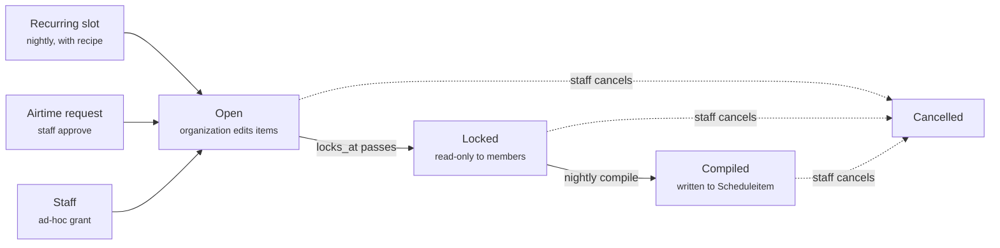

# ADR 0001: Airtime grants replace member scheduling

- Date: 2026-11-11
- Last revised: 2026-11-23

## Status

Accepted 2026-11-11, and in production since the cut-over that evening. This record is kept up to date with what was decided while implementing it; [History](#history) lists the revisions. [ADR 0002](0002-jukebox-selection.md) covers how the jukebox picks videos.

Not yet built: video submissions, notifications, and parts of [Related cleanup](#related-cleanup), each marked there.

## Context

Before this decision the broadcast schedule (`Scheduleitem`) had three writers: member organizations through the API, a nightly weekly-slot filler, and a nightly jukebox that filled every remaining gap with filler video. Weeks were drafted two Mondays ahead, open to members for one week, then frozen. Most of the scheduling code existed to referee these writers.

- **No hard constraint on overlaps.** Every writer checked for conflicts and then inserted. `select_for_update` locks only rows that already exist, so two writers could take the same empty airtime.
- **A displacement rule every writer had to know.** Jukebox filler gave way to member picks and slot placements, and the nightly run repacked the slivers left behind.
- **Reservations weren't real.** A weekly slot only held airtime once a video was placed in it. A slot with no source, or the unused tail of a slot, was filled by the jukebox.
- **New slots started late.** The slot filler wouldn't displace filler in frozen weeks, so a newly approved slot first aired one to two weeks out.
- **Slot owners and members competed.** Both counted as deliberate programming, so whoever reached the airtime first kept it. In practice that was the nightly run at 00:05 on Monday.
- **Hours of filler.** The jukebox filled everything not otherwise programmed. The channel would rather air less, better programming.
- **Members worked on the live schedule.** They had to understand freeze boundaries, open weeks and displacement to get on air.

## Decision

Organizations stop editing the schedule. Staff grant them windows of airtime, each organization fills in a list of what plays in its window, and a station-side compiler turns those lists into `Scheduleitem` rows. Anything unprogrammed airs as broadcast graphics.

1. **Airtime grants** are the unit of allocation: one organization, one window, one ordered list of videos and text posters (and, put there by staff, graphics). Grants never overlap.
2. **Grants come from three places**: recurring slots (daily, weekly, fortnightly, monthly and so on, expanded by the nightly job), staff directly, or organizations' requests that staff approve.
3. **A grant locks** for members at a deadline, by default the Monday before its week airs. Staff can exempt a grant from locking, on their own or at an organization's request, and staff can edit any grant until it ends.
4. **Grants can program themselves** from a recipe: everything the owner uploads, one of the owner's series, a playlist, or the jukebox. Recurring slots give each grant a recipe, so an organization that does nothing still gets its slot filled with its own content. Items the owner picks are pinned, and the recipe fills the time they leave.
5. **The jukebox stops filling gaps.** It survives as a recipe the station uses on airtime it gives itself.
6. **Late uploads** use a video entry created ahead with its duration set by hand. The file can follow.
7. **Programmes start on a five-minute grid**, with a short breather after the one before.
8. **Graphics fill what isn't programmed.** Gaps, leftover time and empty grants show graphics, put up by playout, never as schedule items. Staff can also schedule a particular graphic, such as the infographics, in a grant. There's no fixed broadcast day: members can schedule at any hour.
9. **Only the compiler and staff write `Scheduleitem`.**
10. **Scheduling moves into its own apps**: `scheduling` for slots, grants, locking and compiling, and `programming` for recipes, with one service layer owning every state change and one module owning broadcast time (see [Related cleanup](#related-cleanup)).

## Airtime grants

A grant is a window of airtime given to one organization, plus the list of what plays in it. It's the only way deliberate programming reaches the air.

```python
class AirtimeGrant(models.Model):
    organization = models.ForeignKey(Organization, on_delete=models.PROTECT)
    starttime = models.DateTimeField()
    endtime = models.DateTimeField()
    airtime = models.GeneratedField(...)  # tstzrange(starttime, endtime, "[)")
    state = models.CharField(choices=State)  # open / locked / compiled / cancelled
    locks_at = models.DateTimeField()  # deadline for members' edits
    lock_exempt = models.BooleanField(default=False)  # members may edit until air
    recipe = models.ForeignKey("programming.Recipe", null=True, on_delete=models.SET_NULL)
    origin_slot = models.ForeignKey(RecurringSlot, null=True, on_delete=models.SET_NULL)


class GrantItem(models.Model):
    grant = models.ForeignKey(AirtimeGrant, related_name="items", on_delete=models.CASCADE)
    position = models.PositiveIntegerField()
    video = models.ForeignKey(Video, null=True, on_delete=models.PROTECT)
    poster = models.ForeignKey(Poster, null=True, on_delete=models.PROTECT)
    graphic = models.ForeignKey(Graphic, null=True, on_delete=models.PROTECT)
    duration = models.DurationField(null=True)  # only for a graphic
    pinned = models.BooleanField(default=False)  # chosen by the owner
```

**Constraints**

- An exclusion constraint on `AirtimeGrant.airtime` (`&&`) for every grant not cancelled. It was a new table with no historical overlaps, so it is strict.
- One grant per slot occurrence: unique on `(origin_slot, starttime)`, counting cancelled grants.
- `GrantItem`: exactly one of `video`, `poster` and `graphic` is set; `duration` is set exactly when `graphic` is, and is at least 5 seconds.
- `GrantItem`: unique on `(grant, position)`, `DEFERRABLE INITIALLY DEFERRED`, so reordering inside a transaction doesn't trip it.
- The list, laid out on the grid, must fit inside the window. No overruns.
- A grant's `Scheduleitem` rows stay inside its window (deferred constraint triggers), whatever path edits them.

**Rules**

- A grant may list any organization's video. The video's owner remains the responsible editor for what they publish, so eligibility checks the owner.
- `origin_slot` is provenance only. A grant copies the slot's time when issued, so editing or deleting a slot never moves an existing grant.
- `locks_at` is per grant. Slot grants default to the Monday 00:00 before their week; an ad-hoc grant at short notice gets its own deadline, or is lock-exempt, instead of being born locked.
- Videos and posters bring their own title and length. A graphic has no length; the item gives it one.
- Deleting a video takes it out of every list that has yet to end: the list closes up, an automatic grant's recipe fills the time, and a compiled grant recompiles. Aired rows and the as-run log keep its title. The delete is refused while the video is on air or about to start, or while a grant that has aired it is still on air. `GrantItem.video` stays `PROTECT`, so a delete has to go through `scheduling.services.delete_video`; the API and the admin do.
- Order is an integer position renumbered from 0 on every save: the API takes the whole list and replaces it in one transaction, so clients never send positions.
- `Scheduleitem.weekly_slot` is replaced by `Scheduleitem.grant`, nullable for staff entries and historical rows.

**Who may program**

- Staff, always.
- Otherwise the editor or a member of an approved Frikanalen member organization (`fkmember`), with a confirmed identity.
- Nobody, staff included, programs for a suspended organization (`is_rogue`), and the nightly job issues it no grants.
- Unowned slots, and airtime the station gives itself, belong to the station organization (`STATION_ORGANIZATION_ID`). The public grants API marks such grants `station`, so on-air graphics don't announce the station as a holder.

**Lifecycle**



- **Open.** The organization replaces its list as often as it likes.
- **Locked.** At `locks_at`, members can no longer edit.
- **Compiled.** The items are in `Scheduleitem`.
- **Cancelled.** Staff withdraw the grant, freeing its window. Cancelling a grant on air cuts what is airing at that moment.

A lock-exempt grant skips the member lock: members can edit it until air, and once it is past its deadline every save compiles it at once. A grant that locks empty compiles to nothing and airs graphics.

**Staff edits up to air.** Staff can replace a grant's list in any state but cancelled, until the grant ends; saving a compiled grant recompiles it at once.

- What has started stays: rows that have aired, are on air or start within 30 seconds (`ON_AIR_MARGIN`) are kept untouched at the head of the list, and the rest is laid out again after them.
- Staff can take the programme on air off the air, which cuts its row at the current moment.
- Staff can move a grant's start until air, shorten its end while on air (dropping or cutting what no longer fits), or lengthen it into free time.
- A grant created with a start in the past starts now.

## Requests and lock exemptions

Organizations ask for airtime and for late changes through the same one-way request workflow weekly slots already used, under the neutral name `ReviewedRequest`: a staff decision with a required comment, recorded once.

```python
class AirtimeGrantRequest(ReviewedRequest):
    airtime = DateTimeRangeField()
    grant = models.OneToOneField(AirtimeGrant, null=True, on_delete=models.SET_NULL)
    # approving creates the grant; fails if the window overlaps another grant


class GrantExemptionRequest(ReviewedRequest):
    grant = models.ForeignKey(AirtimeGrant, on_delete=models.CASCADE)
    # approving sets grant.lock_exempt = True
```

- **Airtime requests** name a window. Approval creates the grant. The request carries the same audit constraint as the slot requests, plus "approved if and only if `grant` is set".
- **Late changes mean exemption.** An organization that needs to change a grant after its deadline requests exemption. Staff can also exempt a grant on their own, typically around live broadcasts.
- **Only staff exempt grants.** Organizations can't set the flag themselves.
- **Short-notice grants go on the schedule at once.** A grant that staff create or a request creates, and that is already past its deadline, is filled from its recipe and compiled immediately instead of waiting for the nightly run.
- Slot creation requests carry a recurrence (see [Recurring slots](#recurring-slots)).

## Recurring slots

Recurring slots replace weekly slots. A slot is a recurrence rule, an owner and a recipe; the nightly job turns each occurrence into a grant.

```python
class RecurringSlot(models.Model):  # replaces WeeklySlot
    organization = models.ForeignKey(Organization, null=True, on_delete=models.PROTECT)
    frequency = models.CharField(choices=Frequency)  # daily / weekly / monthly
    interval = models.PositiveSmallIntegerField(default=1)  # 2 = fortnightly, every other month
    weekdays = ArrayField(models.PositiveSmallIntegerField())  # 0 = Monday
    month_weeks = ArrayField(models.SmallIntegerField(), default=list)  # 1 = first, -1 = last
    starts_on = models.DateField()  # anchor: which weeks or months are "on"
    ends_on = models.DateField(null=True)
    start_time = models.TimeField()  # wall clock, Europe/Oslo
    duration = models.DurationField()
    recipe = models.ForeignKey("programming.Recipe", null=True, on_delete=models.SET_NULL)
```

| Pattern | Rule |
| --- | --- |
| Daily | daily, interval 1 |
| Weekdays only | daily, Monday–Friday |
| Weekly | weekly, interval 1, one weekday |
| Fortnightly | weekly, interval 2; `starts_on` sets which weeks |
| Monthly | monthly, e.g. first Thursday |
| Twice a month | monthly, e.g. first and third Thursday |
| Every other month | monthly, interval 2 |

- **Explicit fields, not an iCalendar `RRULE` string**, so rules are easy to validate, build a form for and show to members. Day-of-month rules ("the 15th") can be added if anyone needs them.
- **Occurrences are computed with the broadcast time module**, which turns dates into Oslo instants and handles DST in one place.
- **Exceptions are just cancelled grants.** Skipping one occurrence means cancelling that grant. Issuing is keyed by slot and start time, counting cancelled grants, so a cancelled occurrence is never re-issued.
- **Edits affect only future grants.** Issued grants keep the time they copied.
- **An unowned slot** issues its grants to the station.
- **Requests**: a slot creation request carries a recurrence instead of a day, time and duration. Ownership requests are unchanged. `api/weekly_slot` became `api/recurring-slots`.
- **Migration**: each `WeeklySlot` became weekly, interval 1, its weekday, with `starts_on` set to the migration date.

## Recipes

A recipe answers one question: given a window, its owner and what the owner pinned, what should play? Recipes live in their own app, `programming`, apart from the scheduling tables, so their data model can change without touching grants. Scheduling only points at a recipe.

```python
class Recipe(models.Model):
    organization = models.ForeignKey(Organization, on_delete=models.PROTECT)
    kind = models.CharField(choices=Kind)  # uploads / series / playlist / jukebox


class SeriesSource(models.Model):  # kind "series"
    recipe = models.OneToOneField(Recipe, related_name="series_source", on_delete=models.CASCADE)
    series = models.ForeignKey(Series, on_delete=models.CASCADE)


class PlaylistSource(models.Model):  # kind "playlist"
    recipe = models.OneToOneField(Recipe, related_name="playlist_source", on_delete=models.CASCADE)
    name = models.CharField(max_length=100)
    videos = models.ManyToManyField(Video)


class JukeboxSettings(models.Model):  # kind "jukebox": an optional theme
    recipe = models.OneToOneField(Recipe, related_name="jukebox_settings", on_delete=models.CASCADE)
    name = models.CharField(max_length=100, blank=True)
    categories = models.ManyToManyField(Category, blank=True)
    shortest = models.DurationField(null=True)
    longest = models.DurationField(null=True)
    newer_than_days = models.PositiveIntegerField(null=True)
    older_than_days = models.PositiveIntegerField(null=True)
```

**Kinds**

- **`uploads`**: everything the owner uploads, unaired new videos first, then the least aired.
- **`series`**: one of the owner's series, its newest unaired episode first, then earlier ones.
- **`playlist`**: a hand-picked list of videos.
- **`jukebox`**: the station's weighted draw, narrowed by an optional theme. [ADR 0002](0002-jukebox-selection.md) sets its pool and its quota for new uploads.

What a kind needs lives in a table of its own, with real columns and foreign keys, not JSON parameters, so a new kind or setting is an ordinary model change and migration in `programming`.

**Rules**

- **Recipes always fill the window.** There is no single-video mode and no choice of ordering; each kind has one.
- **Recipes are values.** Choosing something else points the slot or grant at another recipe row. A recipe is never edited in place, so a change never reaches another grant.
- **The choice belongs to each broadcast.** `AirtimeGrant.recipe` is chosen per grant, and can be made the choice for the grant's recurring slot too (`wholeSlot`); `RecurringSlot.recipe` is copied onto every grant the slot issues.
- **A member's slot airs the member's own content.** Only grants the station gives itself are jukebox; leftover time in a member's grant is never filled with jukebox videos.
- **Pinned items.** Items the owner chooses are pinned at the head of the list, and the recipe fills the time they leave. Saving a list without asking for automatic filling makes the grant hand-made and clears its recipe; `POST /grants/{id}/automatic` unpins everything and lets the recipe program the whole window.
- **Recipes pick only imported videos**, with a file and a positive length. A placeholder without a file is something the owner pins by hand.
- **Recipes pick only published videos** (`publish_on_web`), through `Video.objects.airable()`. An unpublished video airs only where someone lists it by hand. One unpublished after a recipe picked it leaves that list straight away, even inside the day before air: a grant yet to start is refilled, one on air closes up behind what has started, and compiling never lays out such a pick.
- Eligibility is one queryset method, `Video.objects.listable()`.

**Doing nothing works**

An organization that never opens the app still has its slot filled: the slot's recipe goes onto each issued grant, the nightly fill picks up new uploads, and the grant compiles. If the recipe finds nothing eligible, the grant compiles empty and airs graphics.

**Refilling until a day before air**

The nightly run refills every grant with a recipe that is open, or locked or compiled and more than 24 hours from air (`REFRESH_UNTIL`), in chronological order with one shared `ScheduleContext` that counts the compiled schedule and every grant's items. Items change only when the answer did, and a compiled grant whose answer changed is recompiled. So new uploads reach air within a day or two, and the exact automatic picks are firm about a day ahead.

## Late uploads

An organization that won't have its file ready in time creates the video entry first, with a title, description and a duration set by hand, and pins it in the grant.

- `Video` already supports entries without a file: `proper_import` stays false until a file is processed. For scheduling, the entry's `duration` is simply set by hand, so no new field is needed.
- **Saving a list**: a file-less video counts as "pending upload" and is accepted. Its hand-set duration is what must fit the window, and what the compiler uses. Pending uploads survive the lock.
- **When the file arrives**: the real duration replaces the hand-set one and the grant recompiles. Shorter is fine; the remainder airs graphics.
- **No file deadline.** If the file is there at air time, it plays. If it isn't, playout shows a notice for the item's slot saying the programme isn't available.

## Live programmes

A live programme is a `Video` that owns a `LiveTransmission` (its live source), with a duration set by hand. It is listed in a grant like any other video.

- It airs live from its source until the video has a file. Once a recording is uploaded, the same video airs as a file.
- Title, description, page and later recording are the same video. There is no separate live entry in a grant or in the schedule.

## Layout, posters and graphics

**Programmes start on the five-minute grid.** `scheduling/layout.py` places each entry; the frontend mirrors it.

- The first entry starts with the grant.
- A video starts at the next five-minute wall-clock mark that is at least 30 seconds (`BREATHER`) after the previous programme ends, so viewers get a moment of graphics between programmes and the schedule shows round times.
- Posters and graphics aren't programmes: one plays straight after whatever is before it, so it can fill the gap a programme leaves, and the next programme still starts on the grid.
- Jukebox grants are padded too. The jukebox airs whole programmes, and spare minutes become graphics between them rather than short clips crammed in at the end.

**Text posters.** An organization makes a `Poster` from an on-air graphics template (`standard` or `notice`): a heading and text, where a blank line starts a new slide. It is listed in a grant like a video and airs for its own duration, which must be at least the time it takes to read every slide once. Light or dark follows the time of day at air.

**Scheduled graphics.** A `Graphic` is an HTML page CasparCG loads, such as `/infographics/`. Only staff list graphics, each with a duration of its own. Playout airs it like the gap graphics, with filler music under it.

**Gap graphics are playout's job.** CasparCG shows broadcast graphics whenever nothing is scheduled: between grants, after a grant's last item and in empty grants. These are never schedule items. Long unprogrammed stretches get infographics rather than filler.

## Feeds

- Posters and scheduled graphics compile to `Scheduleitem` rows (`poster` or `graphic` set), but they aren't programmes: the public schedule and the EPG feeds leave them out (`include_fillers` shows them).
- **Grants get one week's lead time.** Ordinary grants lock on the Monday before their week airs, 7–13 days ahead, and compile the following night. TV-Anytime and XMLTV read the compiled schedule.
- Automatic picks can still change until 24 hours before air, and staff can change anything until air. A change updates the feeds like any other schedule change.

## Nightly pipeline and compiling

The existing CronJob keeps its 00:05 Europe/Oslo schedule and runs four steps. All receive the same `now`, and all are safe to re-run.

1. **Issue.** For each recurring slot occurrence up to the end of the week after next, create a grant if none exists for that slot and start time (counting cancelled grants), with the slot's recipe attached. If the window overlaps an existing grant, skip it and log it: staff gave that airtime to someone else.
2. **Fill.** Refill grants with a recipe, as in [Refilling until a day before air](#refilling-until-a-day-before-air).
3. **Lock.** Every open, non-exempt grant whose `locks_at` has passed locks. Items that can no longer be listed are dropped and logged. Pending uploads are kept.
4. **Compile.** Each locked grant, and each lock-exempt grant past its deadline, is written to `Scheduleitem` as the layout places it, and marked compiled.

**Compiling on demand.** These recompile a single grant at once, replacing its `Scheduleitem` rows in one transaction, and leave rows that have started untouched: staff saving any grant's list or moving its times, saving a lock-exempt grant past its deadline, a short-notice grant being created, a refill that changed a compiled grant, and a pending-upload video's file arriving. Playout follows changes pushed over `/api/playout/events`.

**What no longer runs:** no jukebox stage over gaps, no displacement (grants never overlap, so the compiler only writes airtime it owns), and no filling of grants an organization has made by hand.

## API and permissions

The schedule is read-only for everyone except staff. Organizations work through grants, requests and posters.

| Endpoint | Organization members | Staff |
| --- | --- | --- |
| `GET /scheduleitems` | Read | Read |
| `POST/PATCH/DELETE /scheduleitems` | None | Correct the compiled schedule |
| `GET /grants` | Their organization's grants | All grants |
| `GET /grants/public` | Anyone: whose airtime a day is | Yes |
| `PUT /grants/{id}/items` | Replace the list while open, or until air if exempt; optionally `automatic` with a `recipe` and `wholeSlot` | Until the grant ends |
| `POST /grants/{id}/automatic` | Hand the whole window back to the recipe | Yes |
| `POST /grants` | None | Create ad-hoc grants, optionally with items |
| `PATCH /grants/{id}` | None | Move times, cancel, change deadline, exempt from lock |
| `GET /recurring-slots`, `/recurring-slots/public` | Read | Read; manage slots and their recipes |
| `POST /recurring-slot-requests/…` | Ask for a slot or to take one over | Approve or deny |
| `POST /grant-requests/airtime`, `/exemption` | Ask for a window, or for exemption on a grant | Yes |
| `POST /grant-requests/…/{id}/decision` | None | Approve or deny with a comment |
| `/posters` | Manage their organization's | All |
| `/graphics` | None | Manage |

**Validating a list** is local to the grant, with no airtime conflict checks, since the grant owns its window:

- The list, laid out on the grid, fits inside the window, using the hand-set duration for pending uploads.
- Every video can be listed, or is a pending upload with a duration set. Any organization's video may be listed.
- Posters belong to the grant's organization; graphics are listed only by staff.
- The user may edit the grant now (see [Lifecycle](#lifecycle)).

## Related cleanup

The rework touches every part of the scheduling code, so it also takes on five long-standing design problems next to it.

**1. `Scheduleitem` becomes pure compiler output.** Once only the compiler and staff write it, the row no longer needs to record which of many writers made it.

- Done: provenance is `Scheduleitem.grant`: set means compiled from a grant, null means a staff entry. `schedulereason` stays for historical rows only and is no longer written.
- Done: `Scheduleitem` has its own exclusion constraint on `airtime`, partial on `schedulereason IS NULL` so historical overlaps don't block it.
- Done: `default_name` is kept for historical rows only.
- Not yet: `is_live` is still a stored field rather than derived from the video's live transmission.
- Not yet: scheduled videos are still `SET_NULL`, not `PROTECT`, so deleting a video can leave an aired-history row with no programme.

**2. Broadcast time has one home.** Done: all wall-clock-to-instant conversion goes through `scheduling/broadcast_time.py`, pinned to Europe/Oslo: recurring slot occurrences, default lock times, week boundaries and the issue horizon. DST is handled there, and grants store instants, so after issuing nothing else converts wall-clock times.

**3. One service layer owns state changes.** Done: issue, fill, lock, compile, recompile, exempt, cancel, move and request decisions are functions in `scheduling/services.py`, each in a transaction. Models hold data and constraints; serializers, the admin and the nightly job all call the same functions, so the admin can't bypass the rules.

**4. The request base class gets a neutral name.** Done: `ReviewedRequest`, since airtime and exemption requests inherit from it too.

**5. Scheduling has its own apps.** `scheduling` holds recurring slots, grants, posters, graphics, the request models and the service layer; `programming` holds recipes and selection. `fk` keeps `Video`, `Organization` and the rest of the media side, and `agenda` keeps the public feeds.

- Not yet: `Scheduleitem` itself is still in `fk`.

## Consequences

**Better**

- One writer path to the schedule. Overlaps are prevented by database constraints on grants and on the schedule, not by every writer checking first.
- Reserved airtime is real from the moment a grant exists, including slots with nothing in them yet.
- New slots take effect from the next grant issued, not after the jukebox has filled two weeks.
- Members deal with "your airtime, your list, your deadline", not freeze boundaries and displacement, and an organization that does nothing still airs a full window of its own content.
- Displacement logic, slot-placement refreshing and `still_current` disappear.
- Late uploads and live events have a supported path.
- The amount of filler is a deliberate choice: the jukebox airtime staff create.
- Staff can run the station in the moment: edit, cut and move airtime up to air.
- Scheduling has one home for its rules: one service layer for state changes, one module for broadcast time.

**Costs**

- Occasional producers depend on the jukebox for exposure, and only to the extent staff give it airtime. [ADR 0002](0002-jukebox-selection.md) puts members' new videos first there.
- Organizations without a slot must request airtime, which means staff work for each approval.
- Hours of graphics put weight on playout and on graphics that hold up on air for hours.
- The five-minute grid means a window holds less programme than its length: two 30-minute programmes no longer fit an hour.
- Automatic picks and staff edits can change the published schedule well inside the week's notice the feeds otherwise get.
- The layout rule exists twice, in `layout.py` and in the frontend, and must be kept in step.

**Follow-up work**

- Notifications: reminders before an empty grant locks, dropped items, scheduled videos still missing a file, request decisions.
- The rest of [Related cleanup](#related-cleanup).

## Alternatives considered

| Alternative | Why not |
| --- | --- |
| Keep members on the schedule and add an exclusion constraint | Fixes the races, but keeps displacement, unreal reservations and members reasoning about freeze weeks. |
| A document per weekly slot occurrence (`SlotOccurrence`) | Ties airtime to weekly slots. Ad-hoc airtime is just as important, so the grant is the general concept and the slot one way to make grants. |
| Keep the jukebox filling every gap | Works against a focused roster with less filler. Filler stays available, but only where staff schedule it. |
| Jukebox in a member's leftover time | A member's slot airs only that member's content. |
| Playout's gap graphics as schedule items | Gap graphics are playout's concern. Only graphics staff deliberately schedule are rows. |
| Freeze automatic picks at the lock | Members set and forget, so new uploads should reach air soon. Refilling until a day before air does that; placeholders still give late uploaders a fixed spot. |
| One generic fill rule (pool, ordering, mode), as first built | Every new need (a series, a jukebox theme) became another nullable column, members got "one video" by default, and hand edits lost automatic filling. Recipes with a table per kind and pinned items replaced it. |
| JSON parameters on a recipe | No constraints, no foreign keys, no migrations. |
| Back-to-back items | No breathing room between programmes and unprintable start times. |
| A live transmission as its own grant item | Makes a live programme a second kind of entry with its own title and page, and leaves nothing for the recording to become. |
| Fractional or linked-list ordering of items | Solves concurrent editing of long lists. Grants have short lists saved whole by one organization. |
| A fixed broadcast day, 09:00–21:00 | Once filler only airs in explicit jukebox airtime, there are no hours to keep filled. A fixed window would only stand in the way of members who want to air outside it. |
| Recurrence as a free-form iCalendar `RRULE` string | Hard to validate, build a form for or explain to members. Explicit fields cover the patterns in use: daily, weekly, fortnightly, monthly by weekday. |

## Migration

**What happened to the old code**

| Before | Became |
| --- | --- |
| `jukebox.py` gap-walking (`free_gaps`, `items_for_gap`, `save_placements`) and its tests | Deleted |
| `selection.py` | The jukebox recipe's weighted draw in `programming` |
| `WeeklySlotSource` | Recipes by data migration (first to fill rules, then to recipes) |
| `candidate_videos()`, `videos_queryset()`, `single_video()` | The recipe kinds |
| Eligibility filters in `videos_queryset()` | `Video.objects.listable()` |
| `still_current()` | Removed |
| `WeeklySlot.source` | `RecurringSlot.recipe` |
| `weekly_slots.py` | Grant issuing |
| `draft.py` | Issue, fill, lock, compile |
| `policy.py` displacement (`is_displaceable`, `airtime_conflicts`, `displace`) | Deleted |
| `Scheduleitem.weekly_slot` | `Scheduleitem.grant` |
| `Scheduleitem.REASON_USER`, `REASON_JUKEBOX` | Kept for historical rows; no longer written |
| Source endpoints in `api/weekly_slot` and the frontend | Recipes chosen through the grant and slot APIs |
| Overlap checks in `Scheduleitem.clean()` and the schedule serializer | A partial exclusion constraint on `Scheduleitem.airtime` |
| `WeeklySlot.next_datetime()` and other uses of the active timezone | The broadcast time module, pinned to Europe/Oslo |
| `WeeklySlotRequestBase` | `ReviewedRequest` |
| `WeeklySlot` (day, `start_time`, duration) and `api/weekly_slot` | `RecurringSlot` (weekly, interval 1, same weekday, `starts_on` = migration date) and `api/recurring-slots` |

**Cut-over (2026-11-11)**

The cut-over started a fresh schedule instead of converting the old one. Everything scheduled after the cut-over instant was wiped, and staff rebuilt the schedule under the new rules. Playout stayed scaled to zero until the new schedule was built and checked, so nothing aired from a half-finished schedule.

1. **Before the cut-over:** grants, grant items and the compiler existed, and staff could create and edit grants. Recurring slots existed, with issue and fill steps and a rule carried over from each existing source. Playout was scaled to zero.
2. **At cut-over:** every `Scheduleitem` starting after the cut-over instant was deleted (`cutover_schedule --at … --yes`). Items before it stayed as they were.
3. **Same deploy:** every weekly slot became a recurring slot (weekly, interval 1, same weekday) with its source as its rule, and issuing ran straight away.
4. **Same deploy:** member schedule writes and the jukebox stage were switched off, and the partial exclusion constraint on `Scheduleitem` added.
5. **Then:** staff added grants and jukebox airtime around the slot programming and checked the compiled schedule; playout showed graphics in gaps, scaled back up, and the new schedule went on air.

## Open questions and further proposals

**Open**

Nothing is open at the moment.

**Further proposals, not yet decided**

- **Releasing a grant.** An organization with nothing this week hands the grant back. It moves to a released state and frees the window for staff to re-grant or leave to graphics.
- **Reminders and staff lists.** Email the organization when a grant is a few days from locking empty or short, and when items are dropped. Give staff a list of slots that have locked empty several weeks running, so they can follow up or reclaim the slot.
- **Video submissions.** Members submit a finished video for broadcast, and the jukebox raises the weight of submitted videos that haven't aired yet. Proposed in the first version of this record, not built.

## History

Revisions to this record, with the pull requests that made each change. Version numbers are the django-api release that brought it to production.

| Date | Change | PRs | Release |
| --- | --- | --- | --- |
| 2026-11-11 | Accepted; cut-over on staging and production. | django-api #97; playout #25; frontend #92 | 3.0.0 |
| 2026-11-11 | Staff edit a grant until air, not only until it compiles. | django-api #99 | 3.0.0 |
| 2026-11-11 | A live programme is a video with a live transmission, replacing `GrantItem.live_transmission`. | django-api #100, #101; playout #28; frontend #97 | 3.0.0 |
| 2026-11-13 | Recipes replace fill rules and playlists: kinds instead of pool, ordering and mode; always fill the window; pinned items; refill until 24 hours before air; a member's slot airs only its own content. | django-api #121, #124; frontend #117 | 3.2.0 |
| 2026-11-15 | Recipes pick only imported videos. | django-api #140 | 3.5.0 |
| 2026-11-13 | Short-notice grants are filled and compiled at once. | django-api #130, #132 | 3.3.1 |
| 2026-11-14 | Programmes start on the five-minute grid; grants can list text posters. | django-api #137; playout #34; on-air-graphics #41; frontend #134 | 3.5.0 |
| 2026-11-16 | Staff edit, cut and move grants while on air; a grant's rows stay inside its window. | django-api #142, #144, #146, #148 | 3.8.0 |
| 2026-11-16 | Staff schedule HTML graphics in grants. | django-api #149 | 3.9.0 |
| 2026-11-20 | The public grants API marks the station's own airtime. | django-api #165 | 3.12.0 |
| 2026-11-23 | The jukebox draws on members' videos: see [ADR 0002](0002-jukebox-selection.md). | django-api #175, #176 | 3.12.0 |
| 2026-11-23 | Record revised to describe the system as built. | | |
| 2026-11-25 | Deleting a video takes it out of the lists that list it and refills the time. | django-api (this PR) | |
| 2026-11-26 | Recipes pick only published videos; unpublishing one takes it out of what recipes picked it for. | django-api (this PR) | |
| 2026-11-27 | Jukebox grants are padded like any other; the jukebox airs each video at most once per window. | django-api #203 | |
